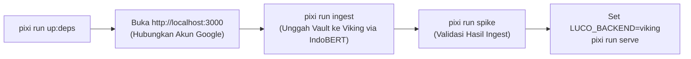

# Panduan Langkah Demi Langkah (WALKTHROUGH.md)

Dokumen ini memandu pengembang, kurator data, dan penguji untuk menjalankan, menguji, dan mengoperasikan seluruh alur kerja **Luco 🐦** dari awal hingga akhir tanpa ada langkah yang terlewat.

---

## 📋 Daftar Alur Kerja (Workflows)

1. [Persiapan Awal & Lingkungan](#1-persiapan-awal--lingkungan)
2. [Alur Pengembangan Lokal (Local Mode)](#2-alur-pengembangan-lokal-local-mode)
3. [Alur Kurasi Data Pengetahuan (Vault Curation)](#3-alur-kurasi-data-pengetahuan-vault-curation)
4. [Alur Stack Penuh Docker (OpenViking + Proxy + Postgres)](#4-alur-stack-penuh-docker-openviking--proxy--postgres)
5. [Alur Pengujian & Evaluasi Benchmark](#5-alur-pengujian--evaluasi-benchmark)
6. [Alur Integrasi Frontend / Klien Eksternal](#6-alur-integrasi-frontend--klien-eksternal)

---

## 1. Persiapan Awal & Lingkungan

### A. Prasyarat Sistem
Pastikan toolchain berikut telah terpasang di sistem operasi Anda:
- [Pixi](https://pixi.sh/) (Conda-based package manager)
- [Docker Engine & Docker Compose v2](https://docs.docker.com/engine/install/)

### B. Setup Repositori
```bash
# 1. Kloning repositori
git clone https://github.com/luco-untan/luco-untan.git
cd luco-untan

# 2. Pasang seluruh dependensi Python & binari secara otomatis
pixi install

# 3. Buat file environment lokal
cp .env.example .env
cp ov.conf.example ov.conf
```

---

## 2. Alur Pengembangan Lokal (Local Mode)

Mode ini memungkinkan Anda menjalankan dan menguji backend secara instan tanpa perlu menyalakan kontainer OpenViking.

### Langkah 1: Jalankan Unit & Integration Test
Pastikan seluruh 58 pengujian unit & integrasi lolos bersih tanpa warning:
```bash
pixi run test
```

### Langkah 2: Bangun Tabel Lookup, JSON Tree Manifest & Validasi Vault
```bash
# Ekstraksi profil dosen ke vault/lookup.json
pixi run build-lookup

# Ekstraksi JSON Tree Manifest hirarki heading ke vault/manifest.json
pixi run build-manifest

# Cek tidak ada tautan internal yang rusak
pixi run check-links
```

### Langkah 3: Menjalankan REPL Terminal Interaktif
Set `LUCO_BACKEND=local` di `.env`, lalu jalankan antarmuka terminal:
```bash
pixi run chat
```
*Ketik pertanyaan Anda (misal: "Siapa NIP Contoh Dosen?") dan periksa respon agen serta verifikasi sitasinya.*

### Langkah 4: Menjalankan REST API Server
```bash
pixi run serve
```
*Server API aktif di `http://localhost:8000`. Dokumentasi interaktif Swagger UI dapat diakses di `http://localhost:8000/docs`.*

### Langkah 5: Menjalankan Web UI Chatbot & Dashboard Monitor
```bash
# Jalankan antarmuka web Vite dev server (port 5173 dengan hot-reload)
pixi run web

# Atau cukup jalankan server API (otomatis menyajikan web interface terkompilasi di http://localhost:8000)
pixi run serve
```
*Buka browser di `http://localhost:5173` atau `http://localhost:8000` untuk login dengan Akun Google (Google OAuth 2.0) atau Mode Tamu, lalu mulai obrolan dan pantau metrik di tab Monitor & Audit.*

---

## 3. Alur Kurasi Data Pengetahuan (Vault Curation)

Setiap kali Anda menambahkan materi kuliah, panduan akademik, atau data dosen baru:

1. **Tambahkan File Markdown Baru:**
   - Profil Dosen: Salin dari `vault/dosen/_template.md` ke subfolder KBK terkait di `vault/dosen/<subfolder-kbk>/nama-dosen.md`.
   - Kurikulum Baru / Pemetaan CPL: Tulis di `vault/akademik/kurikulum/2026/`.
   - Panduan KP & TA: Tulis di `vault/kp-ta/`.
   - Sarana & Lab: Tulis di `vault/fasilitas-lab/`.
2. **Perbarui Lookup:**
   ```bash
   pixi run build-lookup
   ```
3. **Cek Tautan:**
   ```bash
   pixi run check-links
   ```
4. **(Opsional) Mengambil Publikasi Ilmiah via OpenAlex:**
   - Masukkan ID OpenAlex dosen ke `crawl-output/dosen_seed.json`.
   - Jalankan crawler: `pixi run crawl`.
   - Periksa hasil di `crawl-output/<nama-dosen>.md`.
   - Setelah diverifikasi manual oleh manusia, salin tabel publikasi ke `vault/dosen/<nama-dosen>.md` dengan atribut `diverifikasi: true`.

---

## 4. Alur Stack Penuh Docker (OpenViking + IndoBERT + Proxy + Postgres)

Jika Anda ingin menjalankan seluruh ekosistem lengkap termasuk basis data persisten dan retriever semantik vektor berbasis IndoBERT:



### Langkah 1: Nyalakan Sub-Services
```bash
pixi run up:deps
```
Periksa status kontainer:
```bash
docker compose -f dependencies/docker-compose.yml ps
```

### Langkah 2: Hubungkan Akun Google ke Proxy
1. Buka browser: `http://localhost:3000`.
2. Masukkan akun Google yang memiliki akses model Gemini 3 Flash / 3.5 Flash Lite.

### Langkah 3: Ingest Data ke OpenViking
Pastikan berkas arsip zip mentah disimpan di `data-raw/` (bukan di dalam `vault/`) agar OpenViking hanya mengindeks dokumen Markdown pengetahuan:
```bash
pixi run ingest
```
*Catatan:* Konfigurasi `ov.conf` menghubungkan OpenViking ke microservice `luco-indobert` (:8001) menggunakan model `indobenchmark/indobert-base-p1` (768 dimensi) secara lokal tanpa GPU sesuai proposal Lembar Konsultasi. Mode `auth_mode: "trusted"` dan `OPENVIKING_WITH_BOT=0` digunakan untuk integrasi langsung tanpa dependensi bot gateway eksternal.

### Langkah 4: Verifikasi Hasil dengan Spike
```bash
pixi run spike
```
*Pastikan health OK dan pertanyaan uji coba berhasil menemukan dokumen yang relevan.*

### Langkah 5: Jalankan Aplikasi Utama
Ubah di `.env`: `LUCO_BACKEND=viking`, lalu jalankan aplikasi via Docker penuh:
```bash
pixi run up
```

---

## 5. Alur Pengujian & Evaluasi Benchmark

Untuk menyusun laporan ilmiah dan materi presentasi Tugas Besar UAS Kecerdasan Buatan 2026:

### A. Evaluasi Agen RAG & Verifikasi Sitasi
```bash
# 1. Jalankan benchmark Luco RAG (10 pertanyaan kurikulum, KP/TA, profil dosen)
pixi run eval -- --no-baseline

# 2. Periksa ringkasan hasil pengujian
cat eval/reports/run-*.jsonl | tail -n 1
```

Metrik yang dicatat otomatis meliputi:
- Skor Akurasi (1–5)
- Rasio Halusinasi (%)
- Persentase Perilaku Benar (%)
- Rasio Sitasi Tautan Terverifikasi (%)
- Rata-rata Langkah Agen (Reasoning steps)

### B. Komparasi Empiris Model Embedding IndoBERT
Untuk mereproduksi pengujian performa retrieval vektor IndoBenchmark vs IndoLEM:
```bash
# Jalankan script benchmark di dalam microservice luco-indobert
docker exec -i luco-indobert python - < scripts/benchmark_embeddings.py | tee docs/laporan/raw/benchmark_embedding_indobert_comparison.log
docker exec luco-indobert cat docs/laporan/raw/benchmark_embedding_indobert_comparison.json > docs/laporan/raw/benchmark_embedding_indobert_comparison.json
```

Laporan analisis perbandingan lengkap dapat dipelajari pada:
- [`perbandingan_embedding_indobert.md`](file:///home/luco/luco-untan/docs/laporan/final/perbandingan_embedding_indobert.md)
- [`laporan_pengujian_keseluruhan_aplikasi.md`](file:///home/luco/luco-untan/docs/laporan/final/laporan_pengujian_keseluruhan_aplikasi.md)

---

## 6. Alur Integrasi Frontend / Klien Eksternal

Jika Anda menghubungkan antarmuka web (Next.js, React, Vue, atau Open-WebUI):

### Skenario A: Menggunakan REST API Luco (Aplikasi Kustom)
1. **Registrasi / Login:**
   - `POST /v1/auth/register` atau `POST /v1/auth/login` $\rightarrow$ Simpan `access_token` di storage klien.
2. **Load Tampilan Awal:**
   - `GET /v1/session/active` $\rightarrow$ Ambil sesi yang sedang aktif beserta pesan lamanya.
3. **Kirim Pesan:**
   - `POST /v1/chat` dengan payload `{"content": "..."}` $\rightarrow$ Tampilkan respons, sitasi, dan trajectory.
4. **Mulai Obrolan Baru:**
   - `POST /v1/session/clear` $\rightarrow$ Bersihkan layar, arsipkan sesi sebelumnya.
5. **Daftar Riwayat Sesi:**
   - `GET /v1/sessions` $\rightarrow$ Tampilkan di drawer sidebar.

### Skenario B: Menggunakan Klien Standar OpenAI (Open-WebUI / Chatbox)
- **Base URL:** `http://localhost:8000/v1`
- **API Key:** Sembarang string (misal: `none`)
- **Model:** `luco`
- Endpoint `/v1/chat/completions` dapat langsung diakses secara *open/stateless*.

