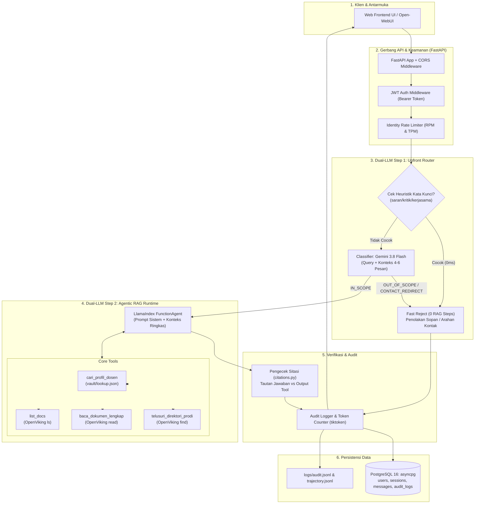
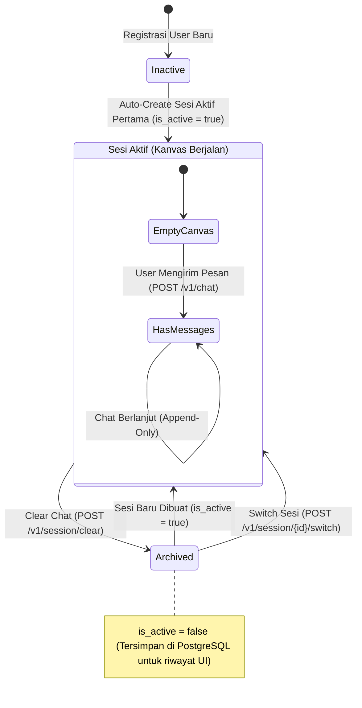

# Arsitektur Sistem Luco

Dokumen ini menjelaskan rancangan arsitektur perangkat lunak **Luco 🐦**, mencakup alur pemrosesan Dual-LLM, mekanisme Agentic RAG berbasis LlamaIndex, manajemen sesi aktif di PostgreSQL, serta sistem verifikasi sitasi.

---

## 1. Filosofi & Pendekatan Utama

Luco dibangun dengan pendekatan **Hybrid Agentic RAG** (Retrieval-Augmented Generation) yang memadukan keunggulan tiga teknologi:
1. **LlamaIndex (`FunctionAgent`):** Berfungsi sebagai otak penalaran (*reasoning engine*) yang secara otonom menentukan alat pencarian yang tepat untuk memecahkan pertanyaan pengguna.
2. **OpenViking:** Berfungsi sebagai mesin *knowledge retrieval* berbasis kontainer Docker yang memindai hierarki dokumen (L0 Ringkasan Root, L1 Ringkasan Folder, L2 Teks Dokumen Lengkap).
3. **Lookup Table (`vault/lookup.json`):** Jalur deterministik berbasis pencarian tepat (*exact match*) untuk data penting yang tidak boleh mengalami halusinasi, seperti NIP dosen, surel resmi, dan jabatan fungsional.

---

## 2. Diagram Alur Sistem (Dual-LLM Pipeline)



---

## 3. Komponen Arsitektur Utama

### A. Upfront Router (`src/luco/router.py`)
Upfront Router bertindak sebagai saringan pertama sebelum request memasuki eksekusi agentic yang membutuhkan banyak token dan panggilan tool:
1. **Deteksi Heuristik Presisi (0 ms Latency):**
   - **Prioritas Identitas Dosen & Peneliti**: Nama dosen dan peneliti (misal *Izuardo, Herry Sujaini, Tursina, dll.*) secara instan diloloskan sebagai `IN_SCOPE` agar agen dapat merespons profil akademiknya.
   - **Pemisahan Rekomendasi vs Kontak Formal**: Sistem membedakan permintaan saran akademik (*"saran dong Dosen PA", "minta saran topik TA"*) dan topik kolaboratif (*"algoritma kerja sama"*) dari pengaduan institusi formal. Permintaan saran akademik diloloskan sebagai `IN_SCOPE`.
   - **Pengalihan Kontak Formal**: Pesan formal seperti permohonan MoU kemitraan vendor, kritik kebijakan kampus, atau pengaduan fasilitas diarahkan langsung ke kontak resmi prodi (WhatsApp: `+62 851-7165-5161`, Email: `info@informatika.untan.ac.id`, Instagram: `@informatika.untan`).
2. **Klasifikasi Cerdas (Gemini Flash Router):**
   Jika bukan kata kunci instan, router membaca pertanyaan bersama **4–6 pesan terakhir** (untuk memahami kata ganti rujukan seperti *"berapa email beliau?"*). Router mengkategorikan pesan ke dalam:
   - `IN_SCOPE`: Informasi akademik, dosen, alur KP, dan TA Informatika UNTAN $\rightarrow$ diteruskan ke Agentic RAG.
   - `OUT_OF_SCOPE`: Pertanyaan di luar cakupan prodi (resep masakan, coding umum non-akademik, gosip).
   - `CONTACT_REDIRECT`: Pesan pengaduan resmi atau ajakan kerjasama bisnis.

### B. Agentic RAG Runtime (`src/luco/agent.py` & `src/luco/tools.py`)
Ketika pertanyaan terbukti `IN_SCOPE`, kendali dialihkan ke LlamaIndex `FunctionAgent`:
- Agen dibekali 4 alat murni tanpa bloat:
  - `cari_profil_dosen(query)`: Membaca [vault/lookup.json](file:///home/luco/luco-untan/vault/lookup.json) untuk mencari nama, NIP, email, jabatan, dan bidang keahlian dosen secara deterministik (100% bebas halusinasi).
  - `telusuri_direktori_prodi(query)`: Memanggil API pencarian OpenViking (vektor dense IndoBERT 768-dim + leksikal BM25) untuk mendapatkan kandidat dokumen dari 104 berkas vault terindeks.
  - `baca_dokumen_lengkap(path)`: Membaca teks lengkap dokumen L2 (dibatasi maksimal 12.000 karakter per pembacaan).
  - `list_docs(path)`: Membaca isi indeks folder untuk eksplorasi navigasi dokumen (7 kategori semantik).
- **Telemetri Alat Presisi Tinggi (`Recorder`)**:
  Selama eksekusi, objek `Recorder` mencatat telemetri berpresisi tinggi untuk setiap alat yang dieksekusi:
  - Durasi pemrosesan dalam milidetik (`duration_ms`, `t_start`, `t_end`).
  - Berkas yang diakses atau ditemukan (`files_accessed`).
  - Estimasi baris/entri berkas yang dibaca (`lines_accessed`).
  - Parameter kueri dan cuplikan aman dari output alat.
- **Standar Format 4-Backtick Anti-Putus**: Seluruh template atau naskah dokumen yang dihasilkan agen wajib dibungkus dengan pembuka dan penutup 4-backtick (` ```` `) agar format kode/tabel internal tidak memutus tampilan di antarmuka obrolan pengguna.

### C. Mesin Pengecek Sitasi (`src/luco/citations.py`)
Untuk mencegah halusinasi tautan (*hallucinated URLs*):
- Setiap kali agen selesai menyusun jawaban, modul `check_citations` mengekstrak seluruh tautan Markdown `[teks](target)`.
- Tautan divalidasi silang terhadap rekaman output tool:
  - Tautan valid jika URL lengkap muncul di output tool ATAU jika berupa path relatif yang teks targetnya tercantum di dalam dokumen yang dibaca agen.
  - Gambar Markdown (``) dikecualikan secara eksplisit via regex *negative lookbehind* `(?<!!)` agar tidak dianggap sebagai sitasi rusak.
- Hasil verifikasi sitasi disimpan ke kolom `citations (JSONB)` di PostgreSQL.

### D. Pipeline Ekstraksi Berkas Resmi (Directus API) & Dual-Option Access
- **26 Berkas Resmi Directus**: Berkas formulir dan panduan resmi kampus (14 PDF & 12 DOCX) diekstrak secara otomatis menggunakan **PyMuPDF4LLM** dan **Mammoth** ke dalam [`vault/dokumen/`](file:///home/luco/luco-untan/vault/dokumen/).
- **Dual-Option Access Paradigm**:
  - `Lihat Naskah .md`: Menampilkan pratinjau teks Markdown interaktif di *Document Drawer* lengkap dengan *Navigation History Stack* (tombol Previous ◀ & Next ▶).
  - `Unduh Berkas Asli (Raw)`: Mengunduh langsung berkas fisik master biner asli berstempel dan bertanda tangan basah dari endpoint `/v1/dokumen/{slug}/raw`.

---

## 4. Desain State & Memori (Single Active Session with Archiving)

Menanggapi evaluasi mengenai *over-engineering* pada chatbot kampus, Luco menerapkan model memori asimetris yang efisien:



### Prinsip Kerja Memori Asimetris:
1. **Integritas Database (PostgreSQL):** Setiap user hanya boleh memiliki **maksimal 1 sesi** dengan status `is_active = true` (ditegakkan oleh *partial unique index* di tingkat basis data).
2. **Tampilan UI (Lengkap):** Seluruh riwayat percakapan dari sesi aktif di-load ke kanvas antarmuka pengguna agar percakapan tetap persisten.
3. **Konteks LLM (Ramping):** Saat request dilempar ke agen LLM, backend **hanya mengambil 4–6 pesan terakhir** dari database. Ini memangkas biaya token hingga 85% dan mencegah jebakan *attention degradation* pada context window yang terlalu panjang.

---

## 5. Keamanan & Identity Rate Limiting (Anti-Ban IP)

Luco mengimplementasikan perlindungan beban produksi yang dirancang khusus untuk lingkungan kampus dan ISP seluler di Indonesia:
- **CGNAT Awareness:** Di jaringan kampus UNTAN atau paket data seluler, ratusan hingga ribuan mahasiswa/dosen berbagi satu alamat IP publik yang sama (*Carrier-Grade NAT*).
- **Identity-First Limiting:** 
  - Pengguna terautentikasi dibatasi berdasarkan `user:{user_id}` (20 request/menit, 40.000 token/menit, 200.000 token/hari).
  - Percobaan login dibatasi berdasarkan `login:{email}` (5 percobaan/menit).
  - Alamat IP tidak pernah di-ban secara global, mencegah pemblokiran massal bagi pengguna lain di jaringan yang sama.

---

## 6. Audit & Monitoring Terukur

Sistem monitoring dan audit Luco dirancang untuk memberikan visibilitas penuh terhadap biaya, performa, dan kepuasan pengguna:
1. **Pencatatan Ganda Asinkron:**
   - Setiap transaksi dicatat ke tabel `audit_logs` di PostgreSQL dan file append-only `logs/audit.jsonl` menggunakan `asyncio.to_thread` tanpa memblokir event loop server.
2. **Perhitungan Token Bertingkat (*Granular Token Attribution*):**
   - Menggunakan tokenizer resmi `tiktoken` (`cl100k_base`).
   - Memecah konsumsi token menjadi 3 komponen:
     - `user_prompt_tokens`: Token dari pertanyaan asli pengguna.
     - `system_prompt_tokens`: Token dari system persona dan aturan keamanan.
     - `context_tokens`: Token dari data hasil penelusuran dokumen tools.
     - `completion_tokens`: Token keluaran jawaban model.
3. **Analisis Latensi Multi-Fase (*Micro-Timing Breakdown*):**
   - Memetakan latensi sistem ke dalam fase-fase kritis:
     - `router_latency_ms`: Waktu klasifikasi Step 1 (heuristik / LLM router).
     - `tools_total_ms`: Total durasi eksekusi seluruh tools beserta rincian per tool (`tool_calls_breakdown`).
     - `llm_final_generation_ms`: Waktu inferensi sintesis jawaban akhir oleh LLM.
     - `total_latency_ms`: Waktu respons end-to-end dari request masuk hingga payload dikirim.
4. **Loop Umpan Balik Kualitas (*Feedback Loop*):**
   - Integrasi langsung reaksi pengguna (`like` / `dislike`) dari antarmuka obrolan ke log audit untuk melacak kepuasan dan kualitas retrieval secara kontinu.

---

## 7. Perbandingan Arsitektur: Rancangan Awal vs Arsitektur Final

Diagram alur awal yang dirancang pada fase konseptual (lihat lampiran evaluasi tim) telah disederhanakan secara signifikan setelah peninjauan kualitas (*quality audit*) dan diskusi tim:

| Komponen | Rancangan Awal (Diagram Konseptual) | Arsitektur Final (Implementasi Nyata) | Alasan Perubahan / Dampak |
| :--- | :--- | :--- | :--- |
| **Manajemen Riwayat** | *Sliding Window + Rolling Summary* (LLM merangkum percakapan lama secara berkala). | **Slicing Riwayat Ringkas** (Hanya 4–6 pesan terakhir dikirim ke LLM; riwayat penuh tetap ada di DB untuk UI). | Menghilangkan pemanggilan LLM berulang hanya untuk membuat ringkasan, menghemat biaya token dan latensi hingga 80%. |
| **Pencarian Chat Lama** | Tool `search_past_chats` + PostgreSQL Full-Text Search (GIN Index). | **Dihapus Sepenuhnya**. 4 core tools fokus pada pengetahuan akademik prodi. | Chatbot prodi bersifat faktual-akademik, bukan *personal memory assistant*. Tidak memerlukan pencarian obrolan lampau lintas sesi. |
| **Kategori Upfront Router** | Menghasilkan kategori `IN_SCOPE`, `OUT_OF_SCOPE`, `CONTACT_REDIRECT`, dan `CROSS_SESSION`. | Menyaring murni: `IN_SCOPE`, `OUT_OF_SCOPE`, dan `CONTACT_REDIRECT` (0 RAG calls untuk penolakan/kontak). | Kategori `CROSS_SESSION` tidak lagi diperlukan karena sistem memori telah disederhanakan. |
| **Paradigma Sesi** | *Multi-session drag-and-drop context injection*. | **Single Active Session with Archiving** (1 pengguna = 1 sesi aktif, sesi lama diarsipkan). | Menghilangkan kompleksitas UI dan state transfer yang rawan bug serta boros context window. |
| **Perlindungan Beban** | Hanya JWT Auth dasar tanpa kontrol kuota/token. | **Identity-First Rate Limiter** (RPM, TPM, TPD) + Token Pre-flight Check via `tiktoken`. | Menjamin ketersediaan layanan dan mencegah tagihan API membengkak tanpa merugikan pengguna CGNAT. |
| **Deteksi Gelar Dosen** | Pencarian string nama persis (*exact string match*). | **Lookup Normalisasi Gelar** (Mendukung input *"Dr. Budi"*, *"Prof. Budi"*, *"Pak Budi"*). | Meningkatkan akurasi retrieval nama dosen pada pertanyaan natural mahasiswa. |


