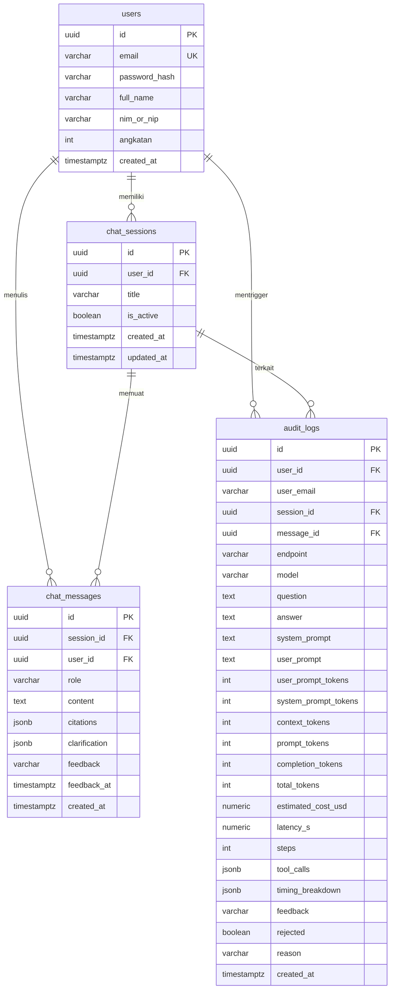

# Desain Database PostgreSQL Luco

Dokumen ini menjelaskan struktur basis data relasional PostgreSQL 16 yang digunakan oleh Luco, mencakup definisi tabel, integritas relasional, indeks parsial unik, dan skema audit performa.

---

## 1. Ikhtisar Arsitektur Basis Data

- **DBMS:** PostgreSQL 16 (Image: `postgres:16-alpine`)
- **Driver Python:** `asyncpg` (koneksi asynchronous berkecepatan tinggi)
- **Ekstensi:** `uuid-ossp` (menghasilkan Primary Key bertipe UUID v4)
- **Skema DDL:** [`src/luco/schema.sql`](file:///home/luco/luco-untan/src/luco/schema.sql)
- **Visualisasi ERD:** Diagram relasi antar-entitas dapat dilihat pada dokumen visual [docs/ERD_v1.png](file:///home/luco/luco-untan/docs/ERD_v1.png).



---

## 2. Struktur Tabel & Kolom

### A. Tabel `users`
Menyimpan identitas akun pengguna, kredensial hash kata sandi, serta metadata akademik.

| Kolom | Tipe Data | Keterangan |
| :--- | :--- | :--- |
| `id` | `UUID` (PK) | Identifier unik pengguna, *default* `uuid_generate_v4()`. |
| `email` | `VARCHAR(255)` (UNIQUE, NOT NULL) | Alamat surel unik pengguna. |
| `password_hash` | `VARCHAR(255)` (NOT NULL) | Hash kata sandi dengan enkripsi `bcrypt`. |
| `full_name` | `VARCHAR(255)` (NOT NULL) | Nama lengkap pengguna. |
| `nim_or_nip` | `VARCHAR(50)` | Nomor Induk Mahasiswa (NIM) atau NIP Dosen. |
| `angkatan` | `INT` | Tahun angkatan mahasiswa (opsional). |
| `created_at` | `TIMESTAMPTZ` | Waktu pembuatan akun (default UTC sekarang). |

---

### B. Tabel `chat_sessions`
Mengelola sesi obrolan pengguna dengan paradigma *"Single Active Session with Archiving"*.

| Kolom | Tipe Data | Keterangan |
| :--- | :--- | :--- |
| `id` | `UUID` (PK) | Identifier sesi obrolan. |
| `user_id` | `UUID` (FK) | Berelasi ke `users.id` dengan opsi `ON DELETE CASCADE`. |
| `title` | `VARCHAR(255)` | Judul sesi (default: `'Percakapan Baru'`, diperbarui otomatis via LLM). |
| `is_active` | `BOOLEAN` (NOT NULL, DEFAULT `true`) | Menandai apakah sesi ini merupakan kanvas aktif yang dibuka pengguna. |
| `created_at` | `TIMESTAMPTZ` | Waktu sesi dibuat. |
| `updated_at` | `TIMESTAMPTZ` | Waktu pembaruan aktivitas terakhir. |

#### Indeks Parsial Unik (Database Integrity Guarantee):
```sql
CREATE UNIQUE INDEX IF NOT EXISTS idx_one_active_session_per_user 
ON chat_sessions(user_id) WHERE (is_active = true);
```
> [!IMPORTANT]
> Indeks parsial ini memberikan jaminan ketat di level PostgreSQL bahwa **seorang pengguna tidak akan pernah memiliki lebih dari 1 sesi aktif sekaligus**. Saat sesi baru dibuka atau sesi lama diaktifkan, sesi aktif sebelumnya dipaksa menjadi `false`.

---

### C. Tabel `chat_messages`
Penyimpanan pesan obrolan berbasis model *append-only* (tidak pernah di-update atau dimanipulasi).

| Kolom | Tipe Data | Keterangan |
| :--- | :--- | :--- |
| `id` | `UUID` (PK) | Identifier pesan. |
| `session_id` | `UUID` (FK) | Berelasi ke `chat_sessions.id` (`ON DELETE CASCADE`). |
| `user_id` | `UUID` (FK) | Berelasi ke `users.id` (`ON DELETE CASCADE`). |
| `role` | `VARCHAR(20)` | Peran pengirim: `'user'` atau `'assistant'`. |
| `content` | `TEXT` (NOT NULL) | Isi pesan teks obrolan. |
| `citations` | `JSONB` (DEFAULT `'[]'`) | Daftar sitasi terverifikasi yang dihasilkan agen. |
| `clarification` | `JSONB` | Metadata opsi klarifikasi interaktif jika terdeteksi kueri ambigu. |
| `feedback` | `VARCHAR(10)` | Umpan balik pengguna (`'like'`, `'dislike'`, atau `NULL`). |
| `feedback_at` | `TIMESTAMPTZ` | Waktu pemberian umpan balik. |
| `created_at` | `TIMESTAMPTZ` | Waktu pesan dikirim. |

#### Indeks Terapan:
- `CREATE INDEX idx_messages_citations ON chat_messages USING gin(citations);` (Mempercepat query pelacakan sitasi dokumen).
- `CREATE INDEX idx_messages_session_time ON chat_messages(session_id, created_at ASC);` (Optimalisasi sliding-window 4-6 pesan untuk LLM).

---

### D. Tabel `audit_logs`
Tabel audit analitik untuk keperluan penelitian, evaluasi akurasi, dan penghitungan biaya operasional model kecerdasan buatan.

| Kolom | Tipe Data | Keterangan |
| :--- | :--- | :--- |
| `id` | `UUID` (PK) | Identifier log audit. |
| `user_id` | `UUID` (FK, NULLABLE) | User ID pengirim request (null untuk guest). |
| `user_email` | `VARCHAR(255)` | Surel pengguna untuk kemudahan identifikasi di dashboard. |
| `session_id` | `UUID` (FK, NULLABLE) | Sesi obrolan terkait. |
| `message_id` | `UUID` (FK, NULLABLE) | ID pesan asisten terkait di `chat_messages` (`ON DELETE SET NULL`). |
| `endpoint` | `VARCHAR(100)` | Endpoint yang dipanggil (misal: `/v1/chat`, `/v1/chat/completions`). |
| `model` | `VARCHAR(100)` | Model LLM yang digunakan (misal: `gemini-3.8-flash-high`). |
| `question` | `TEXT` | Pertanyaan asli pengguna. |
| `answer` | `TEXT` | Jawaban akhir dari asisten atau pesan fast-reject. |
| `system_prompt` | `TEXT` | Teks system prompt utuh yang diumpankan ke model saat eksekusi. |
| `user_prompt` | `TEXT` | Teks kueri prompt pengguna yang diproses. |
| `user_prompt_tokens` | `INT` | Jumlah token dari prompt kueri pengguna saja. |
| `system_prompt_tokens` | `INT` | Jumlah token dari prompt sistem persona agen. |
| `context_tokens` | `INT` | Jumlah token data/konteks hasil penelusuran tools. |
| `prompt_tokens` | `INT` | Akumulasi token masukan total (`user + system + context`). |
| `completion_tokens` | `INT` | Jumlah token keluaran (jawaban model). |
| `total_tokens` | `INT` | Akumulasi total token yang dikonsumsi (`prompt + completion`). |
| `estimated_cost_usd` | `NUMERIC(10, 6)` | Estimasi biaya LLM dalam mata uang USD. |
| `latency_s` | `NUMERIC(6, 2)` | Durasi pemrosesan dalam satuan detik. |
| `steps` | `INT` | Jumlah langkah penalaran dan pemanggilan tool agen. |
| `tool_calls` | `JSONB` | Rekaman trajectory alat yang dipanggil (dengan durasi ms, files, lines, output). |
| `timing_breakdown` | `JSONB` | Durasi terperinci: `router_latency_ms`, `tools_total_ms`, `tool_calls_breakdown`, `llm_final_generation_ms`, `total_latency_ms`. |
| `feedback` | `VARCHAR(10)` | Umpan balik pengguna (`'like'`, `'dislike'`, atau `NULL`). |
| `rejected` | `BOOLEAN` | `true` jika request ditolak oleh Upfront Router (0 RAG calls). |
| `reason` | `VARCHAR(50)` | Alasan penolakan (`out_of_scope`, `contact_redirect`, dll). |
| `created_at` | `TIMESTAMPTZ` | Waktu eksekusi request. |

