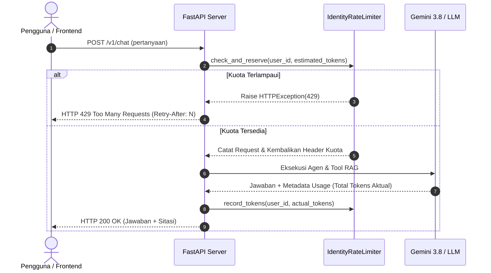

# Sistem Pembatasan Laju (Rate Limiting) & Anggaran Token

Dokumen ini menjelaskan latar belakang teknis, arsitektur, dan implementasi modul pembatasan laju (*rate limiting*) dan kuota token di Luco ([src/luco/ratelimit.py](file:///home/luco/luco-untan/src/luco/ratelimit.py)).

---

## 1. Masalah Kritis: Mengapa Dilarang Melakukan Ban IP di Produksi?

Banyak pengembang pemula menerapkan rate limiter berbasis IP publik (`request.client.host`). Pada sistem produksi skala nyata di Indonesia, pendekatan ini memiliki kecacatan fatal akibat **Carrier-Grade NAT (CGNAT)**:

1. **Satu IP Dipakai Ribuan Pengguna:**
   - Operator seluler (Telkomsel, Indihome, XL, Tri) dan jaringan WiFi kampus Universitas Tanjungpura menempatkan ratusan hingga ribuan perangkat di balik satu alamat IPv4 publik yang sama.
2. **Dampak Pemblokiran Naif (*Collateral Damage*):**
   - Jika satu mahasiswa menjalankan skrip otomatis yang agresif dan server merespons dengan memblokir IP tersebut, maka **seluruh mahasiswa dan dosen di satu gedung, satu fakultas, atau bahkan satu regional kota akan ikut terblokir**.
3. **Ketidakefektifan Melawan Penyerang Cerdas:**
   - Penyerang yang berniat jahat dapat merotasi alamat IPv6 atau menggunakan proxy perumahan (*residential proxy*) dengan sangat mudah, sementara pengguna sah di jaringan kampus menjadi korban pemblokiran.

---

## 2. Pendekatan Luco: Identity-First Rate Limiting

Luco menerapkan pembatasan bertingkat berdasarkan **identitas terotentikasi**, bukan alamat IP fisik:

```
[Request Masuk]
       │
       ▼
Apakah request terotentikasi (JWT Bearer)?
       ├── YA  ──► Kunci Identitas: "user:{user_id}"
       │            Batas: 20 req/menit, 40.000 token/menit, 200.000 token/hari
       │
       └── TIDAK ─► Endpoint /v1/auth/login?
                    ├── YA ─► Kunci Identitas: "login:{email}"
                    │          Batas: 5 percobaan/menit (Anti Credential Stuffing)
                    └── TIDAK ─► Endpoint /v1/chat/completions (Guest)
                               Kunci: "guest:completions" (Sliding Window Soft Throttle)
```

Dengan desain ini:
- Mahasiswa A dan Mahasiswa B yang sama-sama terhubung ke WiFi Fakultas Teknik UNTAN memiliki kuota yang sepenuhnya terpisah.
- Jika kuota Mahasiswa A habis, Mahasiswa B tetap dapat menggunakan chatbot tanpa gangguan sedikit pun.

---

## 3. Algoritma Dual-Metric Sliding Window

Panggilan API Model Bahasa Besar (LLM) tidak bisa hanya dibatasi oleh jumlah request. Satu request dengan dokumen setebal 20 halaman dapat menguras biaya yang setara dengan 100 request biasa. Oleh karena itu, Luco membatasi dua dimensi sekaligus:

### A. Dimensi 1: Requests Per Minute (RPM)
- **Default:** 20 permintaan per menit per pengguna.
- **Tujuan:** Mencegah *rapid-fire spamming* atau loop kode klien yang tidak sengaja berjalan tanpa henti.

### B. Dimensi 2: Tokens Per Minute (TPM) & Harian (TPD)
- **Default TPM:** 40.000 token per menit.
- **Default TPD:** 200.000 token per hari.
- **Tujuan:** Melindungi anggaran operasional API Gemini / DeepSeek dari lonjakan biaya mendadak.

---

## 4. Pre-Flight Estimation & Post-Flight Reconciliation

Salah satu tantangan dalam rate limiting LLM adalah jumlah token keluaran (*completion tokens*) belum diketahui sebelum model selesai menghasilkan teks. Luco menyelesaikan masalah ini melalui alur dua tahap:



1. **Pre-flight Check:** Sebelum LLM dipanggil, fungsi `count_tokens` (berbasis `tiktoken cl100k_base`) menghitung perkiraan token prompt ditambah buffer estimasi jawaban. Jika estimasi ini melebihi sisa TPM atau batas harian, sistem langsung membatalkan eksekusi dengan `HTTP 429`.
2. **Post-flight Reconciliation:** Setelah LLM selesai merespons, fungsi `record_tokens` memasukkan angka token aktual yang dikonsumsi ke dalam sliding window pengguna.

---

## 5. Header Respons Standar (RFC 6585)

Setiap request menyertakan informasi kuota transparan pada header HTTP:

| Header | Penjelasan |
| :--- | :--- |
| `X-RateLimit-Limit-Requests` | Batas maksimum request per menit yang diizinkan (misal: `20`). |
| `X-RateLimit-Remaining-Requests` | Sisa kuota request yang tersedia dalam window berjalan. |
| `X-RateLimit-Limit-Tokens` | Batas maksimum token per menit (misal: `40000`). |
| `X-RateLimit-Remaining-Tokens` | Sisa kapasitas token yang dapat dikonsumsi dalam window 60 detik. |
| `Retry-After` | Durasi penantian dalam satuan detik sebelum pengguna dapat mengirim request baru (hanya muncul pada status `429`). |

---

## 6. Dampak Efisiensi Token RAG terhadap Daya Tahan Kuota (TPM Resilience)

Berdasarkan hasil pengujian empiris pada dokumen komparasi [`perbandingan_context_stuffing_vs_arsitektur_luco.md`](file:///home/luco/luco-untan/docs/laporan/final/perbandingan_context_stuffing_vs_arsitektur_luco.md):
- **Pendekatan Context Stuffing (Inject Langsung)**: Membutuhkan rata-rata **50.008 token per request**. Akibatnya, satu request saja sudah langsung melanggar batas default `40.000 TPM` dan memicu `HTTP 429 Too Many Requests`.
- **Pendekatan Hybrid Agentic RAG Luco**: Hanya mengonsumsi rata-rata **1.120 token per request** (penghematan 97,76%). Dengan konsumsi yang sangat efisien ini, seorang pengguna aktif dapat berinteraksi secara lancar hingga 20 request per menit tanpa pernah menyentuh plafon batas token TPM atau harian. Hal ini membuktikan bahwa arsitektur Hybrid RAG tidak hanya menghemat biaya, tetapi juga menjadi prasyarat mutlak bagi keberhasilan sistem rate limiting produksi.

