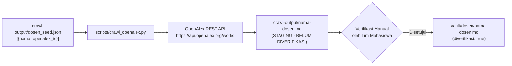

# Manajemen Pengetahuan & Format Vault

Dokumen ini menjelaskan struktur repositori pengetahuan (*knowledge base*) Luco di folder [`vault/`](file:///home/luco/luco-untan/vault/), skema metadata YAML frontmatter, generator tabel lookup, validator tautan, serta alur kerja crawler publikasi dosen OpenAlex.

---

## 1. Filosofi Sumber Kebenaran (Single Source of Truth)

Seluruh pengetahuan resmi Program Studi Informatika UNTAN disimpan dalam format **catatan Markdown (.md)** dengan header **YAML Frontmatter**:
- **Dapat Dibaca Manusia & Mesin:** Catatan dapat diedit dengan mudah menggunakan editor teks biasa (VS Code, Obsidian) maupun diproses secara terstruktur oleh skrip otomatis.
- **Transparansi Sitasi:** Setiap fakta penting menyertakan field `sumber` yang memuat nama rujukan dan tautan asli dokumen.
- **Kemandirian Vault:** Format ini tidak terikat pada vendor database vektor tertentu; data dapat dipindahkan atau diindeks ulang ke sistem retrieval mana pun dengan mudah.

---

## 2. Struktur Direktori Vault (7 Kategori Modular — 104 Dokumen)

Sistem pengetahuan disusun ke dalam **7 kategori semantik** untuk mendukung struktur pencarian hierarkis OpenViking (L0 Root $\rightarrow$ L1 Folder $\rightarrow$ L2 Teks Lengkap) dan pencarian deterministik:

```
vault/
├── lookup.json                             # Data deterministik NIP/email 33 dosen (build-lookup)
├── manifest.json                           # Manifest struktur heading H1-H3 104 dokumen (build-manifest)
├── README.md                               # Pintu masuk utama & indeks repositori
│
├── profil/                                 # Identitas & Tata Kelola
│   ├── README.md                           # Panduan navigasi profil
│   ├── kontak.md                           # Kontak resmi prodi (WA: +62 851-7165-5161, email, IG, alamat)
│   ├── visi-misi.md                        # Visi keilmuan, misi tridharma, & tujuan prodi
│   ├── struktur-organisasi.md              # Pimpinan jurusan, kaprodi, kalab, ketua KBK
│   ├── akreditasi.md                       # Status LAM INFOKOM & BAN-PT, platform SPOTA/EDOXID
│   ├── program-magister-s2.md              # Profil dan izin operasional Program S2 Informatika UNTAN
│   ├── tim-pengembang.md                   # Silsilah pengembang (Balin, Ragil, Andrean, Edwin, Adjie)
│   ├── benchmark-dan-evaluasi-model.md     # Hasil benchmark empiris IndoBERT, 3 mode, & 78 unit tests
│   ├── komparasi-context-stuffing-vs-hybrid-rag.md # Komparasi multi-turn (hemat 97,76% token & 96,66% biaya)
│   └── sejarah-untan.md                    # Latar belakang historis UNTAN & Fakultas Teknik
│
├── akademik/                               # Kurikulum & Pedoman Belajar
│   ├── README.md                           # Ikhtisar sistem akademik
│   ├── profil-lulusan-cpl.md               # 10 Capaian Pembelajaran Lulusan (CPL) & profil lulusan
│   ├── kurikulum/                          # Kategori Induk Kurikulum
│   │   ├── README.md                       # Perbandingan Kurikulum 2016 vs 2026
│   │   ├── 2026/                           # [Jalur Aktif - 140 SKS]
│   │   │   ├── README.md                   # Ikhtisar Kurikulum 2026
│   │   │   ├── tahap-pembelajaran.md       # 4 Tahap Pembelajaran (Semester 1 s.d. 8)
│   │   │   └── pemetaan-cpl.md             # Matriks relasi CPL 01-10 ke mata kuliah
│   │   └── 2016/                           # [Arsip Historis - 144 SKS]
│   │       ├── README.md                   # Ikhtisar arsip 2016
│   │       └── sebaran-semester.md         # Sebaran mata kuliah Semester I s.d. VIII
│   └── panduan/                            # Panduan Operasional Mahasiswa
│       ├── peraturan-akademik-krs.md       # Batas SKS berdasarkan IPS, prosedur KRS, evaluasi studi
│       ├── beasiswa-dan-pmb.md             # KIP-Kuliah, Bank Indonesia, Djarum, & jalur PMB
│       └── kehidupan-kampus-pontianak.md   # Panduan biaya hidup, kos, transportasi Pontianak
│
├── kp-ta/                                  # Alur Tahap Akhir Studi
│   ├── README.md                           # Ikhtisar tahapan kelulusan
│   ├── panduan-kp.md                       # Syarat 80 SKS, prosedur tempat magang, seminar KP
│   ├── panduan-ta.md                       # Syarat 110 SKS, SPOTA, proposal, semhas, befd
│   └── template-dokumen.md                 # Katalog berkas template dengan opsi naskah .md vs unduh raw
│
├── dokumen/                                # [26 Berkas Resmi Directus API]
│   ├── README.md                           # Katalog 26 berkas formulir & pedoman resmi
│   ├── 01-sop-kerja-praktek.md             # SOP Pelaksanaan KP (PDF)
│   ├── 02 s.d. 06 formulir-kp.md           # Formulir KP-IF-00 s.d. KP-IF-05 (DOCX/PDF)
│   ├── 07-pedoman-akademik-untan-2023.md   # Buku Pedoman Akademik 288 Halaman (PDF)
│   ├── 08 s.d. 10 formulir-kp.md           # Formulir Penilaian KP (DOCX)
│   ├── 11-pedoman-proposal-skripsi.md      # Pedoman Penulisan Proposal 2022 (PDF)
│   ├── 12-pedoman-skripsi-2022.md          # Pedoman Penulisan Skripsi Lengkap (PDF)
│   ├── 13-tamplate-proposal-skripsi.md     # Template Naskah Proposal (PDF)
│   ├── 14-tamplate-skripsi.md              # Template Naskah Skripsi Lengkap (PDF)
│   ├── 15 s.d. 18 prosedur-draft-spota.md  # Formulir & Prosedur SPOTA (DOCX)
│   ├── 19-prosedur-wisuda.md               # Prosedur Pengesahan & Wisuda (PDF)
│   ├── 20 s.d. 21 kalender-akademik.md     # Kalender Akademik 2025/2026 & 2026/2027 (PDF)
│   ├── 22 s.d. 25 akreditasi.md            # Arsip SK Akreditasi Prodi (PDF)
│   └── 26-sertifikat-keanggotaan-aptikom.md # Sertifikat Keanggotaan APTIKOM (PDF)
│
├── dosen/                                  # 33 Profil Dosen Lengkap per KBK
│   ├── README.md                           # Roster lengkap 33 dosen dikelompokkan per KBK
│   ├── index.md                            # Indeks pencarian data dosen
│   ├── _template.md                        # Template standar profil dosen
│   ├── ai-komputasi/                       # KBK Computation & Artificial Intelligence (8 Dosen)
│   ├── rpl-mobile/                         # KBK Software Engineering & Mobile Computing (7 Dosen)
│   ├── jaringan-keamanan/                  # KBK Networking & Security (6 Dosen)
│   ├── si-spasial/                         # KBK Information System & Data Spatial (8 Dosen)
│   └── umum/                               # Dosen Baru / Penempatan Lintas Bidang (4 Dosen)
│
├── fasilitas-lab/                          # Sarana & Rumpun Riset
│   ├── README.md                           # Ikhtisar fasilitas prodi
│   ├── laboratorium.md                     # 5 Lab (Komputasi Dasar, AI, RPL, SI, Jaringan; 93 PC)
│   └── kelompok-bidang-keahlian.md         # 4 KBK (AI, RPL, Jaringan, SI) & fokus riset
│
└── kemahasiswaan/                          # Kehidupan Kampus & Profil Pengembang
    ├── README.md                           # Ikhtisar kemahasiswaan
    ├── hmif.md                             # 6 Divisi HMIF, kalender agenda, study club
    ├── ragil-amirzaky.md                   # Profil Lead Developer & Systems Architect
    ├── andrean-stephanus.md                # Profil Co-Developer & Evaluation Engineer
    ├── adjie-prasetya.md                   # Profil Co-Developer & Knowledge Vault Curation
    ├── edwin-hermili.md                    # Profil Co-Developer Sistem Production-Ready
    ├── balin-niswah.md                     # Profil Inisiator Skripsi Awal
    └── alumni-tracer-study.md              # IKA Informatika, sebaran karir tracer study
```

---

## 3. Skema Standar YAML Frontmatter

### A. Catatan Dosen (`tipe: dosen`)
Setiap file dosen di `vault/dosen/` wajib mematuhi skema berikut:

```yaml
---
tipe: dosen
nama: Dr. Nama Dosen, S.T., M.T.
nip: "19800101 200501 1 001"
email: nama.dosen@untan.ac.id
jabatan: Lektor Kepala / Koordinator Program Studi
kelompok_keahlian:
  - Rekayasa Perangkat Lunak
  - Kecerdasan Buatan
openalex_id: A5000000000
diverifikasi: true
sumber:
  - nama: Profil Dosen Informatika UNTAN
    url: https://informatika.untan.ac.id/staff/nama-dosen
---

# Dr. Nama Dosen, S.T., M.T.

[Kembali ke Daftar Dosen](index.md)

## Riwayat Pendidikan
- S1 Teknik Informatika, Universitas X (2002)
- S2 Magister Ilmu Komputer, Institut Y (2006)
- S3 Ilmu Komputer, Universitas Z (2015)

## Publikasi Terverifikasi
| Tahun | Judul Publikasi | Venue / Jurnal | Tautan |
|---|---|---|---|
| 2024 | Implementasi Hybrid RAG pada Chatbot Kampus | Jurnal Teknologi UNTAN | [DOI](https://doi.org/10.xxxx/xxxx) |
```

---

## 4. Pipeline Lookup Deterministik (`build_lookup.py`)

Data penting seperti Nomor Induk Pegawai (NIP), alamat surel, dan jabatan resmi dosen **tidak boleh mengalami halusinasi** oleh model generatif. Luco memisahkan pencarian data ini dari mesin pencari vektor:

1. **Ekstraksi Frontmatter:** Skrip [`scripts/build_lookup.py`](file:///home/luco/luco-untan/scripts/build_lookup.py) memindai seluruh file Markdown di `vault/dosen/` yang memiliki field `tipe: dosen`.
2. **Generasi Tabel Lookup:** Skrip menghasilkan file terstruktur [vault/lookup.json](file:///home/luco/luco-untan/vault/lookup.json).
3. **Eksekusi:**
   ```bash
   pixi run build-lookup
   ```
> [!WARNING]
> **JANGAN PERNAH mengedit `vault/lookup.json` secara manual!** File ini akan otomatis ditimpa setiap kali skrip `build_lookup.py` dijalankan. Perubahan data dosen harus selalu dilakukan pada file Markdown sumbernya di `vault/dosen/`.

---

## 5. Validasi Tautan Relatif (`check_links.py`)

Untuk memastikan dokumen saling terhubung dan tidak ada tautan buntu (*broken links*):
- Skrip [`scripts/check_links.py`](file:///home/luco/luco-untan/scripts/check_links.py) memeriksa setiap tautan relatif berformat `[teks](path.md)`.
- Skrip mengabaikan URL eksternal (`http://`, `https://`) dan anchor `#`.
- Jalankan validasi berkala:
  ```bash
  pixi run check-links
  ```
  Jika ditemukan tautan yang mengarah ke file yang tidak ada, skrip mengembalikan *exit code 1* dan mencetak daftar file yang rusak.

---

## 6. Alur Pengambilan Publikasi OpenAlex (Staging Safety)

Untuk melengkapi riwayat publikasi ilmiah dosen tanpa merusak data manual yang sudah ada:



### Aturan Keamanan Integritas Data:
1. **Pemisahan Folder Staging:** Crawler **DILARANG** menulis langsung ke folder `vault/`. Seluruh hasil crawl OpenAlex disimpan di `crawl-output/`.
2. **Klausul Proteksi:** Catatan dosen yang telah memiliki atribut `diverifikasi: true` tidak boleh ditimpa secara otomatis oleh crawler.
3. **Proses Kurasi:** Tim mahasiswa memeriksa kesesuaian karya dosen di `crawl-output/`, membersihkan publikasi yang tidak relevan, lalu menyalinnya ke catatan resmi `vault/dosen/`.

